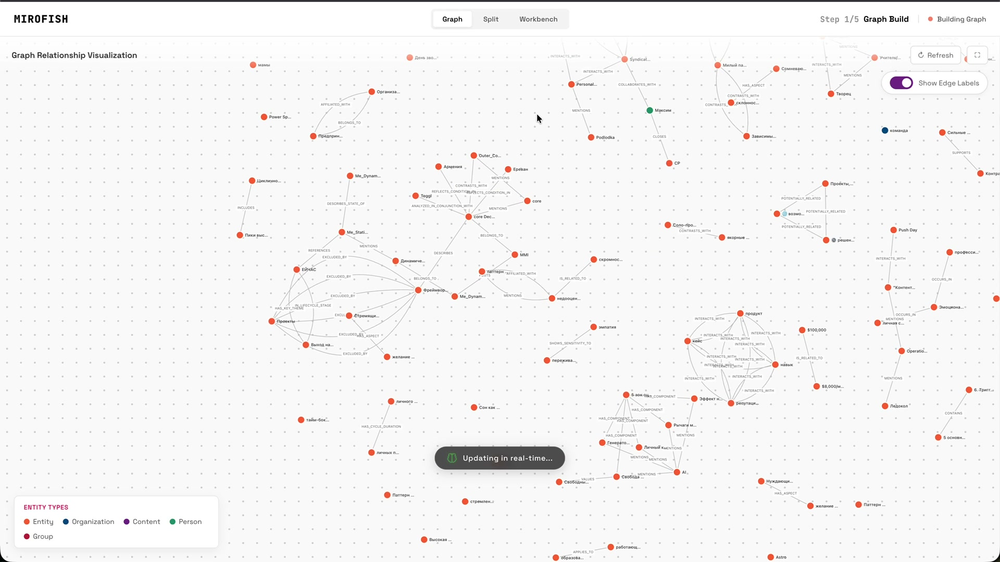

# AI-инструменты в работе — кейсы с конференции

[](https://www.youtube.com/watch?v=vMrl9YGgv4Y)

- **[▶ Запись выступления (YouTube)](https://www.youtube.com/watch?v=vMrl9YGgv4Y)**
- **[→ Открыть слайды (HTML)](https://khabaroff.github.io/shareble-swag/talks/2026-05-15-horseference/deck/)**
- **[Сайт конференции](https://creativehappens.ru/conf/)**

---

**Ведущий:** Сергей Хабаров — консультант, методолог, обучатор в области AI

**Дата:** 15 мая 2026

---

## О чём эта папка

Здесь — материалы публичного выступления: три живых кейса (ThinkFu, CBT-терапевт, Панель экспертов) плюс справочный обзор MiroFish без живого демо. У Панели — два архитектурных варианта: внутрь одной модели (`prompt-expert-panel.md`) и через настоящий совет из разных моделей (LLM Council). Все промпты — шаблоны без личных данных. Можно взять любой и адаптировать под себя, команду, курс или клиента.

**Что внутри:**
- `deck/` — живые HTML-слайды (открыть локально `deck/index.html` или по ссылке выше)
- `khabaroff-presentation.pdf` — слайды выступления (PDF, экспорт из живого деки)
- `prompt-cbt-therapist.md` — системный промпт AI-терапевта (шаблон)
- `prompt-expert-panel.md` — системный промпт Панели экспертов (шаблон)
- `profile_example.md` — демо-профиль вымышленного персонажа (Яков Овсов) для обоих промптов
- `README.md` — этот обзор всех кейсов

---

## Кейс 1 — ThinkFu: библиотека мышления для AI

### В одной фразе
**Каталог из 200+ именованных «мыслительных приёмов» (thinking moves)** с умным роутером: подбирает нужный приём под конкретную задачу.

### Какую проблему решает
LLM после RLHF стали предсказуемыми и «творчески скучными» — отвечают по шаблону. ThinkFu добавляет продуктивное трение: выталкивает модель из дефолтного паттерна мышления, заставляет применить технику из TRIZ, Oblique Strategies, Systems Thinking или Design Thinking.

### Как работает
- **Каталог** — 200+ moves в YAML, у многих есть переменные (домены, персоны, случайные слова) из пулов. Одна шаблонная move → ~500 миллиардов уникальных вариантов.
- **Seed (зерно)** — к каждому ответу тихо добавляется случайное конкретное существительное («наковальня», «устье реки», «печь»). Агент не знает, что оно там есть. Тонко смещает интерпретацию LLM. Одна move + разный seed = разное мышление.
- **Router (3 шага, ~300ms, Cloudflare Edge):**
  1. Контекст задачи → 768-мерный вектор (embedding gemma-300m, ~50ms)
  2. Поиск по Cloudflare Vectorize → 3 похожих move + 2 случайных из того же режима
  3. Малый LLM (llama-3.1-8b) выбирает самую «неожиданно полезную» из 5 кандидатов

Seed-слово — единственное, что LLM не контролирует. Остаётся случайным.

### Режимы
- `plan` — до начала: сломать дефолтный подход
- `explore` — в процессе: расширить пространство поиска
- `stuck` — в тупике: пробить блок
- `evaluate` — после черновика: стресс-тест, проверка на клише
- `matched` (default) — умный роутинг под контекст
- `random` — чистая случайность

### Три аудитории одновременно
- AI-агенты → через MCP-сервер
- Разработчики → через REST API
- Люди → через сайт

### Аналогия автора
Боевые искусства — это именованный, наработанный, обучаемый каталог приёмов. Не придумываешь новый удар в каждом бою — тренируешь репертуар, достаёшь нужный приём. ThinkFu — то же самое, но для когнитивной работы.

### Ключевой инсайт
Случайность — фича, не баг. В творческом мышлении предсказуемость = враг. Seed-слово и «случайные кандидаты» добавлены намеренно.

### Как попробовать
- **Сайт** — https://thinkfu.org/
- **Как работает** — https://thinkfu.org/how
- **GitHub** — https://github.com/move38studios/thinkfu
- **Hacker News (обсуждение)** — https://news.ycombinator.com/item?id=47562162
- **Claude Code plugin** — `/plugin marketplace add move38studios/thinkfu`

### Демо на конференции
✅ Живое

---

## Кейс 2 — CBT-терапевт: AI с памятью о клиенте

### В одной фразе
**Системный промпт превращает AI в когнитивно-поведенческого терапевта,** который помнит вашу историю: терапевтический протокол живёт в промпте, личный контекст — в отдельных документах.

### Какую проблему решает
Обычный AI-терапевт не знает вашу историю, спрашивает каждый раз заново, работает с абстрактным «клиентом». В итоге каждая сессия начинается со знакомства, а не с продолжения.

### Архитектура — 3 слоя
```
[Методология CBT]      ← зашита в промпт, одна для всех
        +
[Профиль клиента]      ← личные документы, загружаются в контекст
        ↓
Персонализированная сессия
```

1. **Методология** — CBT, схема-терапия, mindfulness, trauma-informed. Универсальная.
2. **Профиль клиента** — паттерны, триггеры, субличности. В личных документах.
3. **Сессия** — живой разговор с учётом 1 + 2.

### Плейсхолдеры — не личные данные
Промпт содержит структурные плейсхолдеры:

| Плейсхолдер | Что туда идёт |
|---|---|
| `{ПРОФИЛЬ}` | Глубинная структура личности, субличности |
| `{КОДЕКС_ВИТАЕ}` | Триггеры, страхи, стратегии регуляции |
| `{КОНТЕКСТ}` | Текущие жизненные обстоятельства |
| `{ПРАКТИКИ}` | Личный список проверенных техник |
| `[ЦЕЛИ_КЛИЕНТА]` | Конкретные цели |

Промпт знает **как работать** — но не **с кем**. Личные данные подставляются отдельно.

### Что входит в методологию
- **CBT** — идентификация автоматических мыслей, когнитивная реструктуризация, поведенческие эксперименты, экспозиция
- **Схема-терапия** — работа с ранними дезадаптивными схемами, режимы (субличности), ограниченное репарентирование
- **Mindfulness** — MBCT, элементы ACT, практики осознанности и принятия
- **Trauma-informed** — постепенность и безопасность, защитные механизмы как изначально адаптивные
- **Системный подход** — паттерны в отношениях, межличностные циклы

### Структура сессии
1. Check-in и мониторинг (5–7 мин)
2. Постановка цели сессии (2–3 мин)
3. Основная работа (35–40 мин) — когнитивная / поведенческая / эмоциональная / работа с субличностями / работа со схемами
4. Домашнее задание и навыки (5–7 мин)
5. Завершение и обратная связь (3–5 мин)

### Ключевой инсайт
AI не спрашивает «расскажи о себе». Он уже знает, какие субличности активируются у клиента, какие у него триггеры и какие практики уже работают.

### Файл промпта
`prompt-cbt-therapist.md`

### Демо на конференции
✅ Живое

---

## Кейс 3 — Панель экспертов: 6 голосов вместо одного

### В одной фразе
**Системный промпт собирает 6 виртуальных экспертов** (CFO, Стратег-инвестор, Продюсер, Бренд-стратег, Терапевт, Адвокат дьявола). Каждый смотрит на ситуацию через свою линзу, спорит, приходит к решению.

### Какую проблему решает
Один AI-советник = одна точка зрения. Панель = структурированный конфликт мнений, который вытаскивает на свет то, что один эксперт пропускает.

### Workflow
```
SCOPE → PANEL → ANALYZE → DEBATE → CONVERGE → DELIVER
```

1. **Scope** — что решаем, контекст давления, blast radius, тип решения
2. **Panel** — кого звать (зависит от ситуации)
3. **Analyze** — 4–8 строк на эксперта: оценка, риски, рекомендация, открытый вопрос
4. **Debate** — таблица конфликтов между позициями
5. **Converge** — подход, ключевые решения, митигации, следующие шаги
6. **Deliver** — конкретные действия с цифрами

### 6 экспертов

| Эксперт | Мандат | Сигнатурный вопрос |
|---|---|---|
| 💰 **CFO** | Считает деньги и ROI на час. Отсекает всё, что не окупается | *«Сколько стоит час твоего времени и сколько этот проект платит за час?»* |
| 📈 **Стратег-инвестор** | Каждый проект — актив с risk/reward профилем. Горизонт 1–3 года | *«Что это будет стоить через 2 года? Это остаётся с тобой?»* |
| 📋 **Продюсер** | Защищает календарь. Пропускная способность — жёсткий constraint | *«Сколько часов в неделю это реально займёт? Откуда их берём?»* |
| 🎯 **Бренд-стратег** | Каждое действие через линзу видимости и позиционирования | *«Об этом можно рассказать? Это усиливает позиционирование?»* |
| 🧠 **Терапевт** | Знает паттерны, защищает энергию. Следит за признаками перегрузки | *«Это питает или истощает? Через месяц будешь рад, что взялся?»* |
| 😈 **Адвокат дьявола** | Ищет самообман. Различает решения из силы vs из страха | *«Ты берёшь это из силы или из страха упустить? Это твой актив или чужая проблема?»* |

У каждого эксперта прописан bias (это фича — «зависит от ситуации» убивает ценность) и слепое пятно (поэтому экспертов несколько).

### Тест «своё vs чужое»
- Остаётся со мной (кейс, продукт, навык)? → Своё
- Привлекает мою аудиторию? → Своё
- Разовое решение чужой задачи без следа? → Чужое
- Подстройка под аудиторию mismatch? → Чужое

### Тест «из силы vs из страха»
- Есть выбор, это один из вариантов? → Из силы
- «А вдруг упущу / больше не предложат»? → Из страха
- Чувство расширения? → Из силы
- Чувство «опять вписываюсь»? → Из страха

### Priority Ladder (разрешение конфликтов)
1. 🛡️ Выживание (cash flow)
2. 🔥 Энергия (без перегрузки)
3. 🏗️ Актив (остаётся ли что-то после проекта)
4. 📈 Рост (приближает ли к цели)
5. 🎯 Фокус (усиливает или распыляет)
6. ⚡ Интерес (интеллектуальный вызов)
7. ✨ Красота (никогда не решающий фактор)

### Сценарии
- Брать или не брать входящее предложение
- Как расставить приоритеты на спринт
- Конфликт «деньги сейчас vs актив на будущее»
- Ощущение перегрузки/ступора

### Файл промпта
`prompt-expert-panel.md` — заполните профиль (финансы, проекты, паттерны), используйте.

### Демо на конференции
✅ Живое — на вымышленном персонаже Якова Овсова: соло AI-консультант, доход $2–8K/мес, цель $9K стабильно, входящее предложение в найм за $5K/мес. Брать или нет?

### Архитектурный вариант — LLM Council: настоящий совет из разных моделей

Панель экспертов выше — это шесть ролей внутри одной модели: один LLM играет CFO, потом Стратега, потом Терапевта. Полезно, но все шесть голосов идут из одной «головы», с одним обучением и одним набором слепых пятен. LLM Council — следующий шаг той же идеи: вместо шести персон в одном LLM собирается совет из реально разных моделей (GPT, Claude, Gemini, Grok), каждая отвечает независимо, потом они анонимно оценивают друг друга, и финальный синтез делает «председатель».

**Как работает (3 стадии):**
1. **Параллельные мнения** — вопрос уходит всем моделям одновременно. Каждая отвечает независимо, без доступа к чужим ответам.
2. **Анонимное рецензирование** — каждая модель получает ответы остальных без имён («Ответ А», «Ответ Б»…) и ранжирует по качеству. Анонимность убирает предвзятость: модели не знают, чей ответ оценивают.
3. **Синтез Chairman** — главная модель видит все ответы + ранги → собирает финальный ответ. Не усреднение — синтез лучших аргументов.

**Аналогия.** Когда принимаешь важное решение, спрашиваешь нескольких экспертов, а не одного. Карпаши автоматизировал это для LLM.

**Ключевой инсайт.** Расхождение моделей — сигнал, не баг. Когда пять из шести согласны, а одна спорит — именно там реальная сложность вопроса. Это то же самое наблюдение, что лежит в основе Панели экспертов: ценность не в усреднении, а в подсветке конфликта.

**Цифры.**
- −35.9% галлюцинаций vs лучшая одиночная модель (HaluEval, 1200 примеров)
- +7.8 балла на TruthfulQA
- Стоит в ×4.2 дороже по токенам → оправдано только для важных решений

**Контекст создания.** Weekend hack, 99% vibe-coded. Карпаши написал за субботу, чтобы читать книги с несколькими LLM и сравнивать интерпретации.

**Ссылки:**
- **GitHub оригинал** — https://github.com/karpathy/llm-council (60K+ звёзд, ноябрь 2025)
- **Разбор архитектуры** — https://starlog.is/articles/llm-engineering/karpathy-llm-council
- **Академическая версия (arxiv)** — https://www.arxiv.org/pdf/2604.02923 — Council Mode: −35.9% галлюцинаций
- **SaaS-продукт** — https://llmboard.app/ — совет из 6 моделей, готовый к использованию
- **CLI без API-ключей** — https://github.com/ajfisher/llm-advisors — работает через Codex/Claude/Gemini CLI

### Когда что брать
- **Один LLM + 6 ролей (`prompt-expert-panel.md`)** — дёшево, быстро, помещается в одну сессию, удобно для личных решений. Слепые зоны общие — единая модель.
- **LLM Council из разных моделей** — дороже в ×4, но реально разнородные углы зрения. Для решений, где цена ошибки выше цены ×4 по токенам.

---

## Бонус — MiroFish (без живого демо)

Этот кейс на конференции показывал обзорно: цель не научить пользоваться, а расширить рамку — чтобы остальные три демо выше выглядели логичной частью одного направления, построения составных AI-систем.

---

### MiroFish: цифровой двойник реальности

#### В одной фразе
**Движок группового интеллекта** (swarm intelligence): тысячи AI-агентов симулируют общество — и предсказывают будущее до того, как оно случилось.

#### Какую проблему решает
Реальный мир — однопроходный эксперимент. Нельзя «прогнать» политику или маркетинговую кампанию тысячу раз и посмотреть на распределение исходов. MiroFish строит параллельный цифровой мир, запускает в нём тысячи агентов с личностями и памятью — и смотрит, что произойдёт.

#### Технологическая база
OASIS (Open Agent Social Interaction Simulations) от CAMEL-AI + GraphRAG + multi-agent LLM.

#### Как работает (5 шагов)
1. **Graph Building** — извлечение семян из реального мира, инъекция памяти агентов, построение GraphRAG
2. **Environment Setup** — извлечение связей, генерация персон, настройка агентов
3. **Simulation** — параллельная симуляция на двух платформах, динамическое обновление памяти
4. **Report Generation** — ReportAgent формирует предсказательный отчёт
5. **Deep Interaction** — можно разговаривать с любым агентом внутри симуляции

#### Примеры применений
- **Анализ общественного мнения** — симуляция реакции на событие до публикации (кейс Уханьского университета)
- **Финансовые предсказания** — моделирование реакции рынка на сигналы
- **Политические сценарии** — тест политик без реального риска
- **Литература** — предсказание утраченных концовок («Сон в красном тереме», 80 глав → продолжение)

#### Аналогия
Как flight simulator для пилота — только симулятор будущего для лиц, принимающих решения. Репетируешь событие в цифровой песочнице тысячу раз, прежде чем оно случится в реальности.

#### Масштаб
Тысячи агентов с независимыми личностями, долгосрочной памятью и поведенческой логикой. Не chatbot-ответы — социальная эволюция.

#### Перспектива
- **Macro** — лаборатория для политиков и PR: тест нулевого риска
- **Micro** — творческая песочница: «что если» превращается в результат

#### Контекст
Создан за 10 дней, стал №1 трендом GitHub глобально. AGPL-3.0 open source.

#### Ссылки
- **GitHub** — https://github.com/666ghj/MiroFish (60K+ звёзд, ноябрь 2025)
- **Сайт** — https://mirofish.ai
- **Demo** — https://666ghj.github.io/mirofish-demo/
- **Туториал (YouTube, Tech With Tim)** — https://www.youtube.com/watch?v=QmdCkaTM1P4

#### Демо на конференции
📋 Обзор (без живого демо)

---

## Как использовать промпты

### CBT-терапевт (`prompt-cbt-therapist.md`)

1. Откройте файл
2. Найдите все `{ПЛЕЙСХОЛДЕРЫ}` — они обозначают документы клиента
3. Для демо/тестирования: создайте простые текстовые документы со своими данными
4. Вставьте промпт в Claude → добавьте свои документы как контекст
5. Начните сессию с «check-in»

### Панель экспертов (`prompt-expert-panel.md`)

1. Откройте файл → найдите Шаг 1
2. Заполните профиль: финансы, проекты, часы в неделю, паттерны
3. Скопируйте промпт из Шага 2 в Claude
4. Задайте вопрос: *«Прогони через панель: мне предложили [описание]»*

---

## Что дальше

Все промпты в этой папке — шаблоны. Личных данных нет. Можете адаптировать под себя, команду, курс, клиента.

Вопросы → Сергей Хабаров (khabaroff.com)
